  

  

  
  
  

## 👨‍🚀 Sobre mim

- 🎓 Estudante de **Engenharia de Software** na **Unicid**
- 🌐 Crio sites com **JavaScript, HTML e CSS** e automações com **Python**
- ⚙️ Gosto de deixar projetos se atualizando sozinhos com **GitHub Actions**

## 🛠️ Tecnologias

  
  
  
  
  
  

## 🚀 Missões em destaque

| Missão | Sobre | Lançamento |
| :-- | :-- | :-: |
| 🥋 [**cohab-team**](https://github.com/YagoXavier10/cohab-team) | Site da Cohab Team de Brazilian Jiu-Jitsu: história, conquistas, atletas, campeonatos e notícias | [🌐 Ver site](https://yagoxavier10.github.io/cohab-team/) |
| 📰 [**portfolio-noticias**](https://github.com/YagoXavier10/portfolio-noticias) | Portfólio com notícias atualizadas todo dia via GitHub Actions | [🌐 Ver site](https://yagoxavier10.github.io/portfolio-noticias/) |
| 🤼 [**tatame-online**](https://github.com/YagoXavier10/tatame-online) | Jogos de jiu-jitsu no navegador: luta ao vivo, quiz, relâmpago e mais, com ranking online | [🌐 Ver site](https://yagoxavier10.github.io/tatame-online/) |

## 📡 Painel da nave

  

  <picture>
    <source media="(prefers-color-scheme: dark)" srcset="https://raw.githubusercontent.com/YagoXavier10/YagoXavier10/output/snake-dark.svg" />
    <source media="(prefers-color-scheme: light)" srcset="https://raw.githubusercontent.com/YagoXavier10/YagoXavier10/output/snake-light.svg" />
    
  </picture>

  

